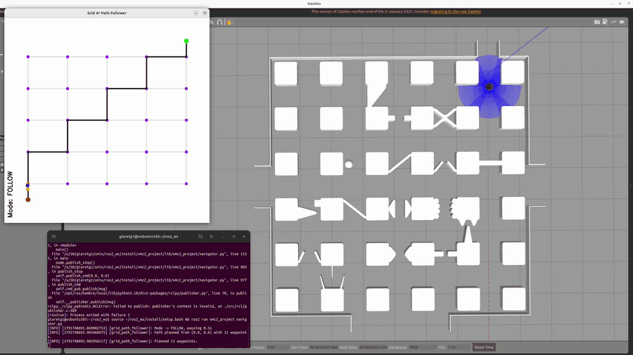
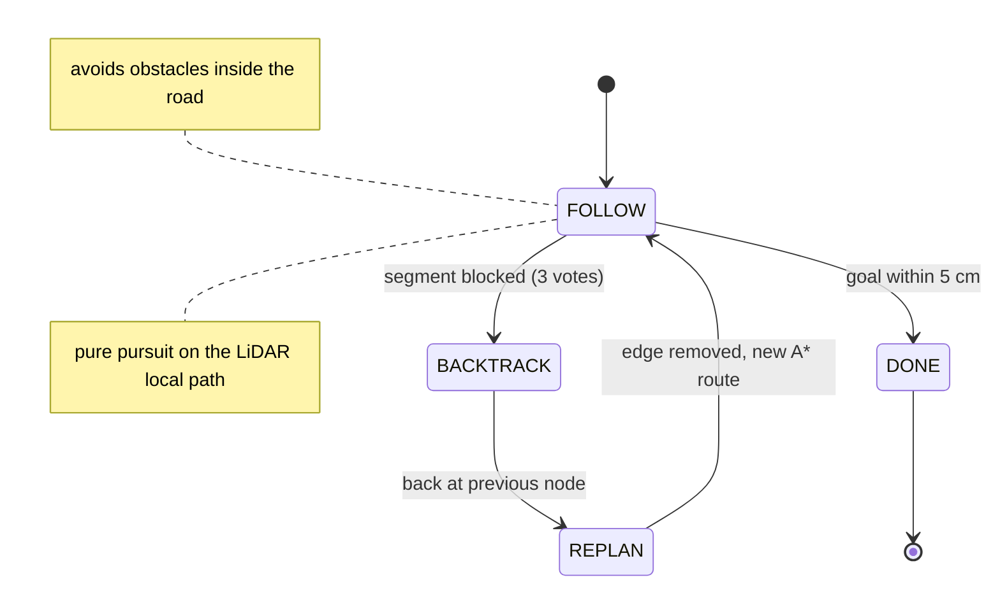

# TurtleBot3 Grid Navigation: A* + LiDAR Local Planning (ROS 2)

A ROS 2 navigation node that drives a **TurtleBot3 Burger** through a road-grid track full of obstacles in Gazebo. The node plans a global route with **A\*** on the road graph. While driving, it builds a **local occupancy grid from the LiDAR** to steer around obstacles. When a road segment turns out to be impassable, it **backtracks, removes that edge and replans**.

> Course project (Group E). The ROS package skeleton, the world and the robot model come from the course. The planning, perception and control logic in [`src/navigator.py`](src/navigator.py) is our implementation.



*Left: the planner view (grid graph, current A\* route, robot and lookahead target). Right: Gazebo. The log shows the FOLLOW → BACKTRACK → REPLAN cycle each time a road is found blocked. The GIF runs at 8× speed.*

## How it works



### 1. Global planning: A\* on the road graph
- The track is a 5×5 grid of intersections, 1.424 m apart, with 4-connected edges.
- A\* runs with a Euclidean heuristic and builds the route as robot pose → nearest node → A\* nodes → goal node → goal.
- **Blocked edges** are removed from the graph and counted. If no route remains, edges are restored step by step: first those blocked only once, then all of them. The robot never gets stuck without a plan.

### 2. Local planning from LiDAR
- Each scan is projected into the world frame using the **robot pose interpolated at the scan timestamp**, taken from a 2 s odometry history. This avoids smearing obstacles while the robot turns.
- Around the current segment, a **segment-aligned occupancy grid** is built: 2.5 cm cells, 0.95 m ahead, ±0.45 m laterally. Cells closer than robot radius + margin (0.089 + 0.02 m) to any LiDAR point are marked occupied.
- **Dijkstra** on this grid uses forward, diagonal and lateral moves, with a clearance penalty near obstacles. It produces a collision-free local path, and the pure-pursuit lookahead is taken on that path.
- If no local path exists for **3 consecutive cycles**, the segment is declared **impassable**. This debounce avoids false positives from single noisy scans.
- Speed is capped automatically in narrow passages (0.12 m/s) and near nodes (0.18 m/s).

### 3. Heading-drift correction
Odometry yaw drifts over a long run. The node fits **straight line segments to the LiDAR wall points** using PCA on 14-point windows and measures how far each wall is from the nearest multiple of 90° in the world frame, since the track is Manhattan-aligned. It then applies a filtered **yaw correction**. All perception and control use this corrected heading.

### 4. Motion control: pure pursuit + PID
- **Pure pursuit** curvature κ = 2 sin α / L<sub>d</sub> on the lookahead target, plus a **PID on the heading error** (K<sub>p</sub> = 2.2, K<sub>d</sub> = 0.1).
- A **repulsion bias** pushes the heading away from walls closer than 13 cm on either side.
- The robot **rotates in place** when the heading error exceeds 0.45 rad or an obstacle is directly ahead.
- Linear speed scales with cos α, is capped at 0.40 m/s and slows down within 0.6 m of the goal. Angular speed is capped at 2.4 rad/s.

## Repository structure

```
src/navigator.py                  ROS 2 node (planning, perception, control, OpenCV visualization)
launch/project.launch.py          Gazebo + TurtleBot3 + track world
launch/spawn_turtlebot3.launch.py Robot spawner
worlds/project.world              Track with obstacles
worlds/project_no_obs.world       Track without obstacles
models/turtlebot3_burger/         Robot model (SDF)
docs/img/demo.gif                 Demo recording
```

## How to run

Tested with **ROS 2 Humble** and **Gazebo Classic 11** on Ubuntu 22.04.

```bash
# dependencies
sudo apt install ros-humble-turtlebot3-gazebo ros-humble-gazebo-ros-pkgs python3-opencv python3-numpy

# build
mkdir -p ~/ros2_ws/src && cd ~/ros2_ws/src
git clone https://github.com/<your-username>/ros2-turtlebot3-astar-navigation.git
cd ~/ros2_ws && colcon build --packages-select vmc2_project
source install/setup.bash
export TURTLEBOT3_MODEL=burger

# terminal 1: simulation
ros2 launch vmc2_project project.launch.py

# terminal 2: navigator
ros2 run vmc2_project navigator.py
```

> The worlds include the track as `model://project_track` (`project_track_no_obs` for the empty version). That track model was provided by the course environment and is not included here. Place it in a folder on your `GAZEBO_MODEL_PATH`.

## Key parameters (`src/navigator.py`)

| Parameter | Value | Meaning |
|---|---|---|
| `lookahead_dist` | 0.35 m | Pure-pursuit lookahead (0.22 m in narrow passages) |
| `v_max`, `w_max` | 0.40 m/s, 2.4 rad/s | Velocity limits |
| `robot_radius` + `safety_margin` | 0.089 + 0.02 m | Obstacle inflation in the local grid |
| `grid_res`, `plan_window`, `plan_half_width` | 0.025 m, 0.95 m, 0.45 m | Local occupancy grid |
| `blocked_votes_needed` | 3 | Consecutive failed local plans before declaring a segment blocked |
| `goal_tol`, `node_tol` | 0.05 m | Arrival tolerances |
